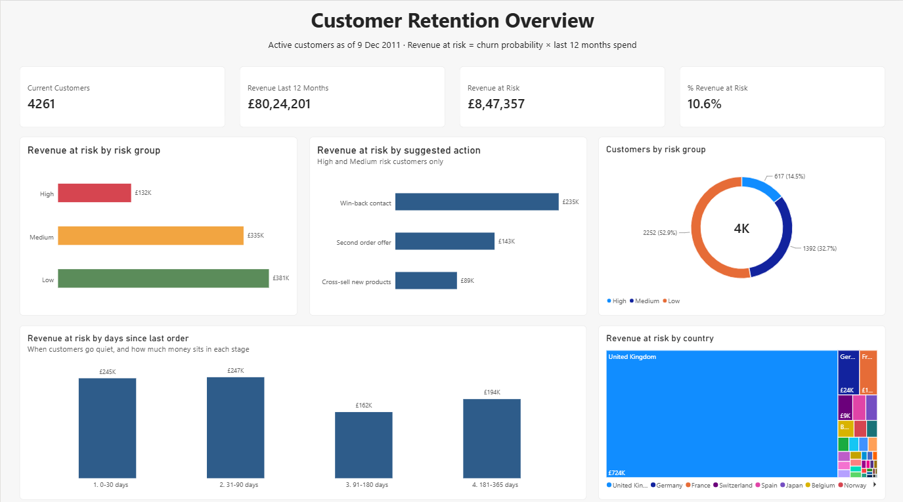
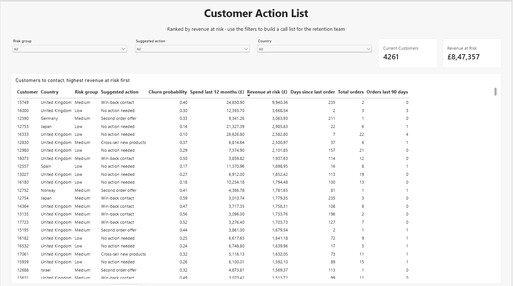
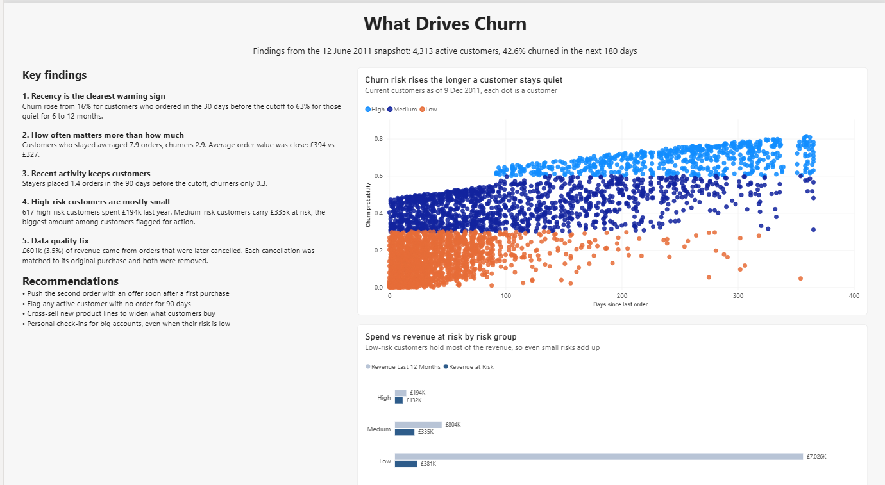

# Customer Retention Intelligence System

Which customers are likely to stop buying, how much revenue is at risk, and what should the business do about it?

An end-to-end analysis of 1M+ transactions from a UK online retailer, from raw data to a churn risk model and a Power BI dashboard a retention team could work from.

**Tools:** SQL (DuckDB) · Python (pandas, scikit-learn) · Power BI · Git

---

## Key results

- **£847k of revenue at risk**, 10.6% of the £8.0m that current customers spent in the last 12 months
- **4,261 active customers scored** for churn risk and given a suggested action (win-back, second order offer, cross-sell)
- **58% of revenue at risk sits with customers who ordered in the last 90 days**, so retention should start early, not after customers go quiet
- **Found £601k (3.5%) of revenue from orders that were later cancelled**, which was inflating the value of a few customers. Fixed before modelling.

---

## Dashboard







Three pages:
- **Overview:** headline numbers, revenue at risk by risk group, suggested action, days since last order and country
- **Action list:** every current customer ranked by revenue at risk, with filters for risk group, action and country
- **Churn drivers:** key findings and recommendations

---

## Business problem

Keeping a customer is usually cheaper than winning a new one. The business needs to know:
1. Which customers are likely to stop buying?
2. How much revenue do they represent?
3. Why are they leaving, and what should we do?

## Data

[UCI Online Retail II](https://archive.ics.uci.edu/dataset/502/online+retail+ii): real transactions from a UK-based online gift retailer, December 2009 to December 2011. 1,067,371 rows across two yearly sheets. Prices are in GBP. Many customers are wholesalers.

---

## Approach

### 1. Data cleaning (Python)

| Step | Rows removed |
|---|---|
| Missing customer ID (can't track who bought) | 243,007 |
| Cancellations (kept in a separate table for analysis) | 18,744 |
| Zero or negative price | 71 |
| Non-product codes (postage, bank charges, manual adjustments) | 2,917 |
| Exact duplicate rows | 26,055 |
| Purchases later cancelled (matched to their cancellation) | 6,179 |

**Result:** 770,398 clean sales lines, 5,839 customers, £16.47m revenue.

**The cancelled orders issue.** The first version of the model flagged one customer with £168k spend as almost certain to churn. Investigating showed that customer placed a single order of 80,995 units and cancelled it 12 minutes later. Removing cancellations had left the original order in the data. I matched every cancellation to its original purchase (same customer, product and quantity, placed before the cancellation) and removed both. This took £601k out of revenue, and the analysis was re-run to confirm the findings still held. See `sql/check_outliers.sql`.

### 2. Churn definition (SQL)

- **Cutoff date:** 12 June 2011, which is 180 days before the data ends
- **Churned:** bought at least once before the cutoff, then nothing in the next 180 days
- **Why 180 days:** sales are very seasonal and peak from September to November. A 180-day window after June includes the Christmas peak, so seasonal buyers get a fair chance to come back before being counted as churned.
- **No data leakage:** every model feature uses only data from before the cutoff
- **Active customers only:** 631 customers who hadn't ordered for over a year were excluded. They're easy to predict and would make the model look better than it really is.

**Result:** 4,313 active customers, 42.6% churned.

### 3. Churn drivers (SQL)

Customers were split into groups for each factor, comparing churn rates.

| Factor | Lowest churn | Highest churn |
|---|---|---|
| Orders before cutoff | 10+ orders: **9.3%** | One order: **68.3%** |
| Orders in last 90 days | Three or more: **4.7%** | None: **58.5%** |
| Product variety | 96+ products: **17.8%** | 1 to 20 products: **62.7%** |
| Time as a customer | 497+ days: **25.9%** | Under a year: **over 50%** |
| Average order value | Above £416: **34.0%** | Under £181: **58.5%** |
| UK vs international | International: **40.4%** | UK: **42.8%** |

### 4. Churn model (Python)

Logistic regression and random forest, tested on 20% of customers the models never saw.

| Model | Accuracy | Precision | Recall | ROC AUC |
|---|---|---|---|---|
| Baseline (guess nobody churns) | 0.574 | | | 0.5 |
| **Logistic regression** | **0.700** | **0.638** | **0.685** | **0.769** |
| Random forest | 0.689 | 0.627 | 0.671 | 0.761 |

Logistic regression was chosen: it scored slightly better and is much easier to explain to a business audience.

### 5. Revenue at risk (Python)

The model learned from the June 2011 snapshot, where the outcome is known, then scored current customers as of 9 December 2011.

**Revenue at risk = churn probability × spend in the last 12 months**

| Risk group | Customers | Spend last 12 months | Revenue at risk |
|---|---|---|---|
| High (60%+) | 617 | £194k | £132k |
| Medium (30 to 60%) | 1,392 | £804k | £335k |
| Low (under 30%) | 2,252 | £7.03m | £381k |

---

## Key findings

1. **The second order is everything.** Churn falls from 68.3% for one-order customers to 9.3% for customers with 10+ orders.
2. **How often matters more than how much.** Customers who stayed averaged 7.9 orders against 2.9 for churners, but their average order values were close (£394 vs £327).
3. **90 days of silence is a warning sign.** Customers with no order in the last 90 days churned at 58.5%, against 4.7% for those with three or more.
4. **Cancellations are a trap if you only count them.** Customers who never cancelled churned the most (52.9%), because many had only ordered once. Looking at cancellations per order showed the real signal: customers who cancel 20%+ of their orders churn more than those who rarely cancel (34.0% vs 14.4%).
5. **High-risk customers are mostly small.** 617 high-risk customers spent £194k between them. Low-risk customers hold most of the revenue, so even small risks add up to £381k.
6. **Location doesn't matter.** UK and international customers churn at almost the same rate.

## Recommendations

| Action | Customers | Revenue at risk |
|---|---|---|
| **Win-back contact** for customers with no order in 90 days | 877 | £235k |
| **Second order offer** for one-time buyers | 731 | £143k |
| **Cross-sell** new product lines to active customers | 401 | £89k |

Plus **personal check-ins for big accounts**, even when their risk is low, because a small risk on a large customer is worth more than a high risk on a small one.

---

## Limitations

- The model learned from a June snapshot and scores customers in December, just after the Christmas peak. Scores are best used as a **ranking of who to contact first**, not exact probabilities.
- Only purchase history is available. Website visits, complaints or marketing data would likely improve the model.
- Customers without a customer ID (23% of raw rows) can't be included in customer-level analysis.

---

## Project structure

```
src/
  01_explore.py            first look at the raw data
  02_clean.py              cleaning, including matching cancelled orders
  03_load_database.py      load clean data into DuckDB
  run_sql.py               helper to run the .sql files
  04_train_model.py        train and compare churn models
  06_score_customers.py    score current customers, revenue at risk, actions
sql/
  01_first_look.sql        orders view, monthly revenue, top countries
  02_churn.sql             churn definition
  03_features.sql          customer features for the model
  04_churn_drivers.sql     churn rate by customer group
  05_current_customers.sql features for current customers
  check_outliers.sql       investigation of the cancelled orders
dashboard/
  customer_retention.pbix  Power BI dashboard
```

## How to run

1. Download `online_retail_II.xlsx` from the [UCI page](https://archive.ics.uci.edu/dataset/502/online+retail+ii) into `data/raw/`
2. Set up Python:
```
python -m venv .venv
.venv\Scripts\activate
pip install -r requirements.txt
```
3. Run in this order:
```
python src/02_clean.py
python src/03_load_database.py
python src/run_sql.py sql/01_first_look.sql
python src/run_sql.py sql/02_churn.sql
python src/run_sql.py sql/03_features.sql
python src/run_sql.py sql/04_churn_drivers.sql
python src/run_sql.py sql/05_current_customers.sql
python src/04_train_model.py
python src/06_score_customers.py
```
4. Open `dashboard/customer_retention.pbix` in Power BI Desktop and click Refresh.
